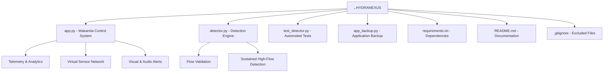

⚡ HYDRANEXUS

INTELLIGENT WATER MONITORING & ANOMALY DETECTION SYSTEM

  <strong>DETECT. ANALYZE. CONSERVE.</strong>

  
  
  

  
  
  

---

◈ SYSTEM OVERVIEW

HydraNexus is a software-based intelligent water-monitoring prototype designed to identify persistent abnormal water-flow patterns and detect potential leakage conditions.

Combining algorithmic flow analysis, configurable detection thresholds, interactive data visualization and a futuristic monitoring interface, HydraNexus transforms water-flow readings into actionable system intelligence.

Inspired by advanced command-and-control interfaces, the Wakanda Control System dashboard provides a unified environment for monitoring virtual sensor nodes, examining telemetry and responding to abnormal flow conditions.

«The mission: Make water-flow intelligence visible, understandable and useful for water conservation.»

---

◈ THE WAKANDA CONTROL SYSTEM

A futuristic monitoring interface built around an intelligent detection engine.

Core capabilities

MODULE| FUNCTION
🧠 Intelligence Engine| Evaluates flow readings and identifies sustained abnormal conditions
🛰️ Virtual Sensor Network| Visualizes distributed monitoring nodes
📡 Telemetry Interface| Displays flow readings and system status
🚨 Alert Engine| Highlights abnormal conditions through visual and audio alerts
📊 Analytics Module| Presents flow patterns through interactive charts and gauges
📁 Data Export| Supports CSV export for further analysis

Visual monitoring

- Animated pipeline and virtual sensor indicators.
- Green status indicators for normal conditions.
- Blinking red indicators during abnormal-flow alerts.
- Browser-based warning sounds with user-controlled activation.
- Interactive telemetry and analytical visualizations.

---

◈ SYSTEM ARCHITECTURE

flowchart TD
    A["FLOW INPUTS"] --> B["DATA VALIDATION"]
    B --> C["DETECTION ENGINE"]
    C --> D{"FLOW CONDITION"}
    D -->|"Normal"| E["NORMAL STATUS"]
    D -->|"Sustained High Flow"| F["ANOMALY ALERT"]
    D -->|"Brief Spike"| G["TRANSIENT EVENT"]
    E --> H["WAKANDA DASHBOARD"]
    F --> H
    G --> H
    H --> I["VISUAL SENSOR NETWORK"]
    H --> J["AUDIO ALERT SYSTEM"]
    H --> K["ANALYTICS & CSV EXPORT"]

Detection methodology

HydraNexus uses threshold-based logic with consecutive-reading validation.

The detection engine evaluates:

1. Input validation and numerical readings.
2. Configurable flow thresholds.
3. Consecutive abnormal readings.
4. Persistent high-flow conditions.
5. Normal, transient and potential leakage scenarios.

The objective is to distinguish a persistent abnormal flow pattern from a short-lived spike.

---

◈ TECHNOLOGY MATRIX

TECHNOLOGY| APPLICATION
Python| Core programming and detection logic
Streamlit| Interactive dashboard
Pandas| Data processing
Plotly| Interactive charts and visual analytics
Streamlit Autorefresh| Dashboard refresh functionality
Git| Version control
GitHub| Source-code hosting

---

## ◈ PROJECT STRUCTURE

---

◈ DEPLOYMENT PROTOCOL

System requirements

- Python 3.10 or newer recommended
- Windows / Linux / macOS
- Internet connection for initial dependency installation

01 — Clone the repository

git clone https://github.com/mohith717/hydranexus.git

02 — Enter the project directory

cd hydranexus

03 — Create a virtual environment (recommended)

python -m venv .venv

Activate on Windows:

.venv\Scripts\activate

Activate on Linux / macOS:

source .venv/bin/activate

04 — Install dependencies

pip install -r requirements.txt

05 — Initialize the dashboard

python -m streamlit run app.py

Open the local application URL displayed in your terminal.

SYSTEM INITIALIZATION COMPLETE.

---

◈ VALIDATION & TESTING

Run the detection-engine unit tests:

python -m unittest test_detector.py

Perform a syntax validation:

python -m py_compile app.py detector.py test_detector.py

The prototype supports scenario-based testing, including:

- Normal water usage.
- Persistent high-flow conditions.
- Brief flow spikes.
- Custom flow readings.

---

◈ HARDWARE INTEGRATION STATUS

Current implementation: Software prototype.

HydraNexus currently uses simulated or manually supplied flow readings. The displayed sensor network represents virtual monitoring nodes; physical sensors are not yet connected.

Future hardware development

- Physical water-flow sensor integration.
- Microcontroller-based telemetry.
- Live IoT communication.
- Cloud-based monitoring and historical data storage.
- Remote anomaly notifications.

These capabilities are planned extensions, not currently implemented hardware features.

---

◈ NEXT-GENERATION DEVELOPMENT

DEVELOPMENT AREA| FUTURE DIRECTION
IoT Integration| Live sensor communication
Machine Learning| Advanced anomaly detection
Cloud Infrastructure| Historical telemetry storage
Smart Notifications| Remote alert delivery
Analytics| Long-term consumption analysis
Scalability| Multi-location monitoring

---

◈ ENGINEERING VISION

Water is one of the most critical resources in our world. Yet unusual consumption patterns and unnoticed leakage can lead to significant wastage.

HydraNexus explores how software intelligence, continuous monitoring concepts and data-driven analysis can help make water management smarter.

From raw flow readings to meaningful intelligence.

From monitoring to conservation.

---

◈ PROJECT IDENTITY

  <strong>HYDRANEXUS</strong>
   
  <em>DETECT. ANALYZE. CONSERVE.</em>
    
  Developed by <strong>Mohith & Team</strong>
   
  YUKTHI 2026 Technical Hackathon

  <strong>⚡ ENGINEER INTELLIGENCE. PROTECT EVERY DROP. 💧</strong>

